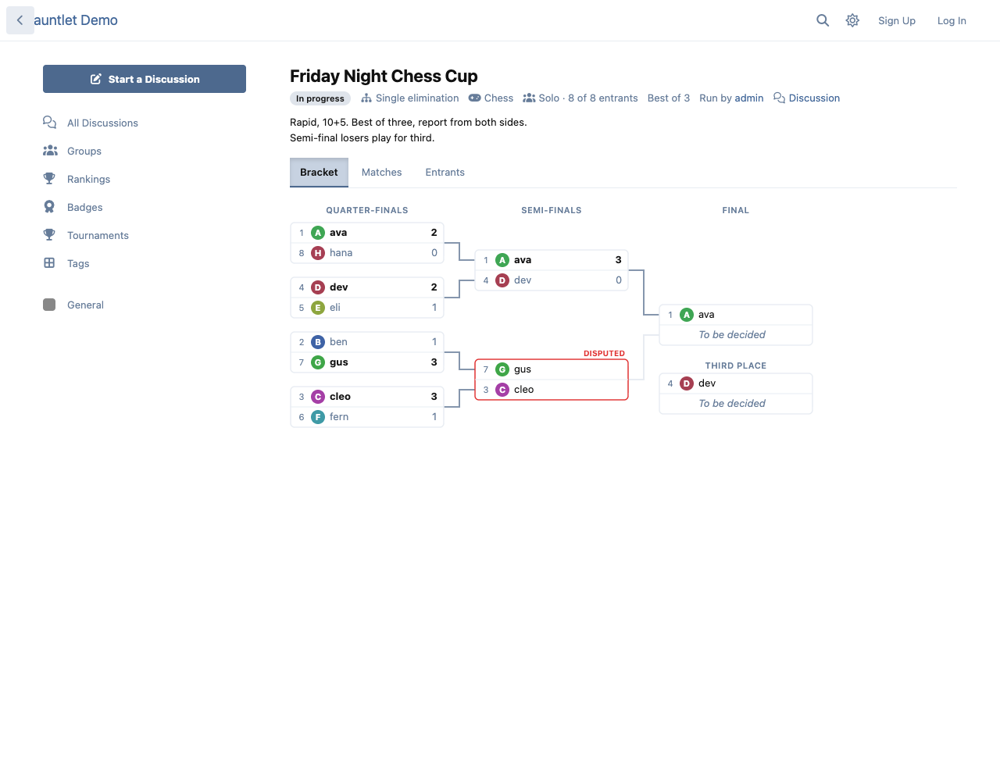
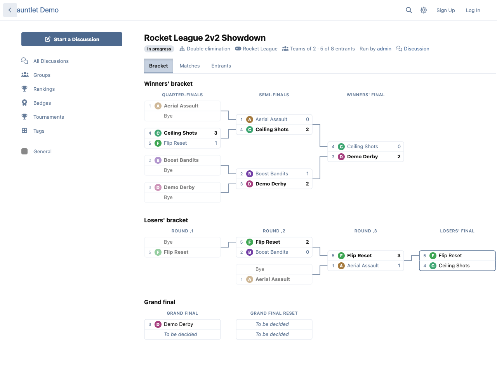
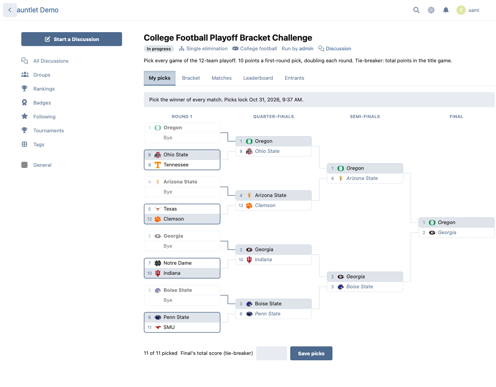
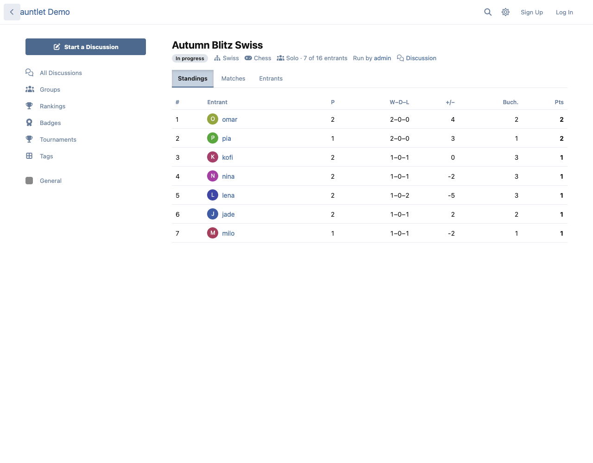
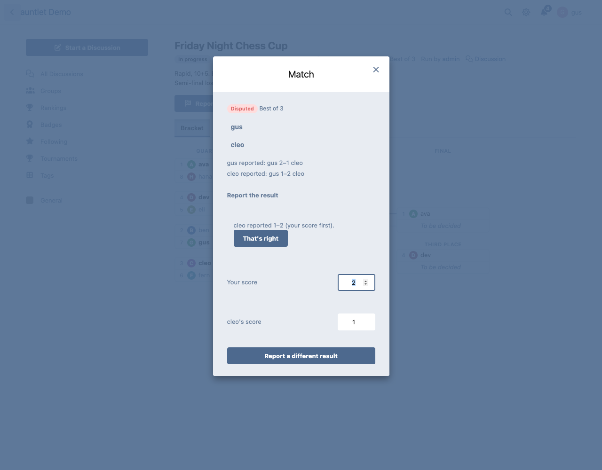
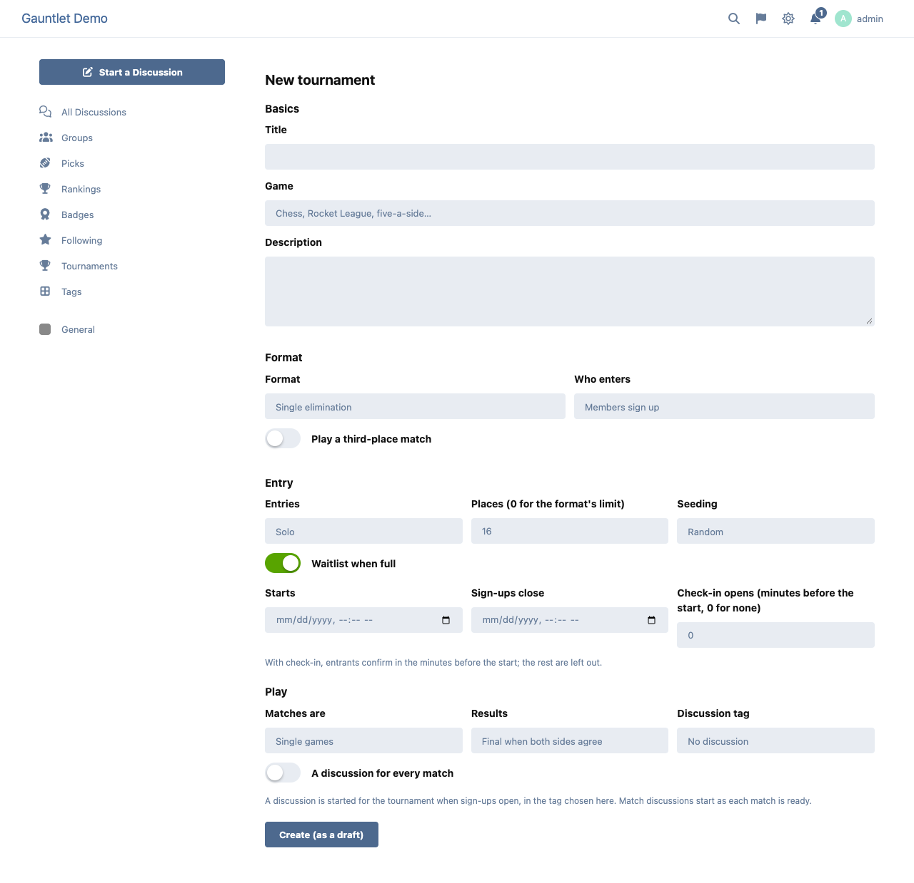
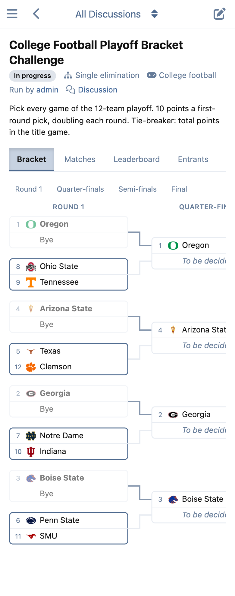

# Gauntlet — tournaments for Flarum

 

Run tournaments between your members — chess, esports, five-a-side, anything with a winner — and prediction brackets for real-world playoffs, inside your forum.



## Features

- **Four formats:** single elimination (with an optional third-place match), double elimination (with an optional grand-final reset), round robin and Swiss. Byes are worked out for any field size and the top seeds get them.
- **Solo or team entries.** A team is a name and a roster members join up to the size you set. With [Social Groups](https://github.com/ernestdefoe/social-groups) installed, a group's creator or moderators can enter the group itself, and only its members can join the roster.
- **Sign-ups** with a cap, an optional waitlist (a withdrawal moves the next member up) and an optional **check-in** window before the start. Anyone who doesn't check in is left out and the checked-in waitlist takes their places.
- **Seeding** at random, by hand, or **by rating**: every member (and every Social Groups team) carries an Elo rating for each game, kept from their results.
- **Results reported by both sides.** When the two reports agree the match is settled. Turn on staff confirmation and every result waits for an organiser. When the reports disagree it's a **dispute**: the organiser is told and rules on it. Organisers can also award a forfeit, and correct a result as long as nothing has been played on top of it.
- **A live bracket**, drawn as SVG at a readable size. On a phone it pans sideways and the round buttons jump to a column. Round robin and Swiss show a table with Buchholz or Sonneborn–Berger tie-breaks.
- **Discussions:** each tournament gets its own discussion when sign-ups open, and if you want, every match gets one as soon as its two sides are known. They're ordinary discussions, in the tag you choose.
- **Notifications** (on the web and by email): your next match is ready, your opponent reported a result, check-in is open, you're off the waitlist, the tournament started or finished, and for organisers, a result that needs a decision.
- **Results on profiles:** each member's tournaments, placings, records, ratings and prediction brackets, on a **Tournaments** tab.
- **Prizes:** a [FoF Badges](https://github.com/FriendsOfFlarum/badges) badge for the winners and [FoF Gamification](https://github.com/FriendsOfFlarum/gamification) points for the top three. FoF Badges also gets three triggers: *tournaments won*, *top-three finishes* and *tournaments played*.
- **Prediction brackets.** The organiser enters a real-world field, such as the College Football Playoff, and members pick the winner of every match before it locks. Correct picks score 10 points in the first round, doubling each round, or whatever you set. The tie-breaker is the final's total score.
- **Built on [Picks](https://github.com/ernestdefoe/picks)** when it's installed. Choose the field from Picks' teams, logos included. Each match links itself to its Picks game, the bracket shows the live score, and when Picks marks a game finished the match settles and every bracket re-scores. There's no second score feed to run.
- Translatable throughout, works in light and dark mode, and adds about 3 KB (gzipped) to the JavaScript every page loads, with no CSS at all. The pages, the bracket and their styles load only when someone opens a tournament.

## Screenshots

| Double elimination | A prediction bracket |
| --- | --- |
|  |  |

| Swiss standings | Reporting a result |
| --- | --- |
|  |  |

| Creating a tournament | On a phone |
| --- | --- |
|  |  |

## Installation

```sh
composer require ernestdefoe/gauntlet
```

Then enable **Gauntlet** in the admin panel. Check-in reminders are sent by Flarum's scheduler, so make sure it runs (`php flarum schedule:run` every minute).

## Updating

```sh
composer update ernestdefoe/gauntlet
php flarum migrate
php flarum cache:clear
```

## Permissions

| Permission | Default |
| --- | --- |
| View tournaments | Everyone, guests included |
| Sign up for tournaments | Members |
| Pick prediction brackets | Members |
| Organise tournaments (their own) | Moderators |
| Manage every tournament | Moderators |
| Attach points and badges to tournaments | Admins |

Prizes have their own permission so that an organiser can't set up a tournament for a second account and pay themselves.

## Points

FoF Gamification recounts a member's points from their votes, so points granted by another extension need its point-grants feature. Until your FoF Gamification version has it, the points fields stay hidden; badges work either way.

## Links

- [Source code on GitHub](https://github.com/ernestdefoe/gauntlet)
- [Report an issue](https://github.com/ernestdefoe/gauntlet/issues)
- ☕ [Buy me a coffee](https://buymeacoffee.com/ernestdefoe)
